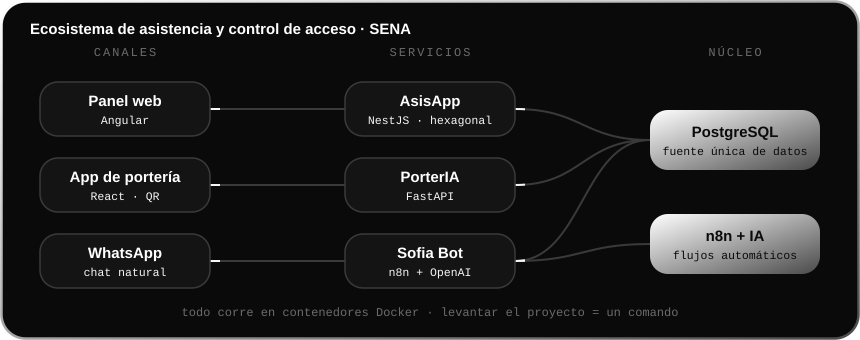
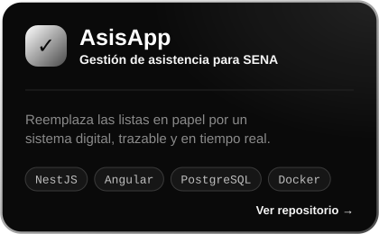
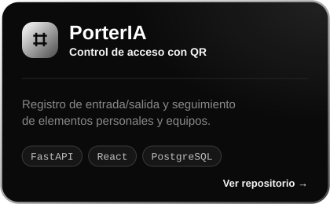
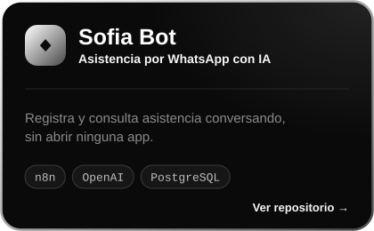

  

 

 

##  Sobre mí

Soy desarrollador **full-stack** formado en el **SENA** (Análisis y Desarrollo de Software). Me especializo en tomar procesos que hoy se hacen a mano o en papel y convertirlos en **sistemas que funcionan solos**: backends con arquitectura hexagonal, interfaces modernas y automatizaciones con **n8n + IA**.

- 🏗️ &nbsp;Diseño backends con **NestJS** y **arquitectura hexagonal**
- 🎨 &nbsp;Construyo interfaces con **Angular** y **React**
- 🤖 &nbsp;Automatizo procesos con **n8n**, bots de **WhatsApp/Telegram** y agentes de IA
- 🗺️ &nbsp;Modelo bases de datos grandes en **PostgreSQL / PostGIS**
- 👁️ &nbsp;Entreno modelos de **visión por computador**
- 🔐 &nbsp;Ahora mismo profundizando en **ciberseguridad y ethical hacking**

 

##  Mi ecosistema de proyectos

  

 

##  Proyectos destacados

<!-- Cambia REEMPLAZA-CON-TU-REPO por el nombre real de cada repositorio -->

  
  
  

<b>🔥 Cómo construyo (clic para abrir)</b>

 

- **Capas separadas:** dominio, casos de uso y adaptadores (puertos y adaptadores) para que el negocio no dependa del framework.
- **Todo en contenedores:** cada servicio corre en Docker para que levantar el proyecto sea un solo comando.
- **Automatización primero:** si una tarea se repite, la convierto en un flujo de n8n o en un endpoint.

 

##  Stack tecnológico

**Backend** 

**Frontend** 

**Datos e infraestructura** 

**IA y automatización** 

**Herramientas** 

 

##  Estadísticas

<!-- Si las tarjetas de github-readme-stats no cargan, la instancia pública está saturada:
     haz deploy gratis de tu propia instancia en Vercel (github.com/anuraghazra/github-readme-stats) y cambia el dominio. -->

 

##  Mi contribución, en forma de serpiente

<!-- Se genera con .github/workflows/snake.yml (ver instrucciones) -->
<picture>
  <source media="(prefers-color-scheme: dark)" srcset="https://raw.githubusercontent.com/alejandro-v02/alejandro-v02/output/github-snake-dark.svg"/>
  
</picture>

 

##  Metas de este año

- [x] Construir un ecosistema real de asistencia y acceso para SENA
- [x] Integrar bots de WhatsApp con IA y n8n
- [ ] Dominar visión por computador aplicada a detección real
- [ ] Profundizar en ciberseguridad y ethical hacking
- [ ] Publicar un proyecto open source con documentación completa

 

##  Conectemos

  

  

<i>"El código es un oficio: lo construyo para que dure y para resolver problemas reales."</i>

